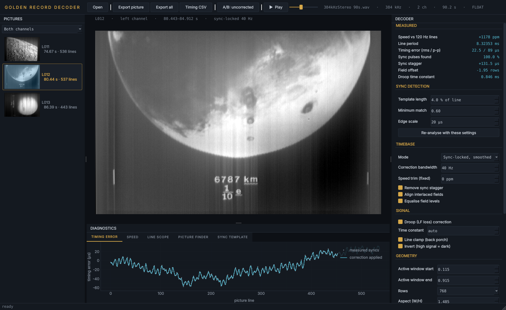
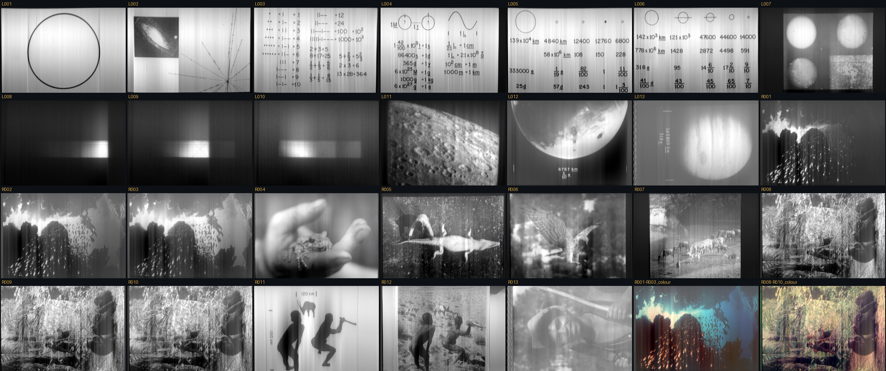

# Golden Record Decoder

Decodes the 116 pictures of the **Voyager Golden Record** from a recording of
its picture section, and corrects the analogue faults of the recording on the
way: wow and flutter, low-frequency loss ("droop"), line-to-line level
jumps, and the interlaced field offset.



The decoder was developed on a 384 kHz / 32-bit float transfer of the 1977
master tape. It works with any WAV/FLAC recording of the picture section
(other sample rates, mono or stereo, from tape or from a disc).



*The first 26 pictures from the first 90 s of the master-tape transfer, both
channels, with default settings. The last two are colour pictures that were
detected and combined automatically.*

## What it does differently

Earlier decoders cut the signal into lines of a fixed length. Speed errors
of the tape then show as bent or wavy lines, and the AC-coupled recording
chain leaves dark shadows and halos. This decoder:

* **locks to every sync pulse.** Each line's sync pulse is located to a
  fraction of a sample by template matching. The measured timing (typically
  ±50 µs of wow and flutter per picture) is turned into a smooth,
  continuous time axis, so speed errors are corrected even inside a line.
* **understands the staggered sync.** On the master tape, sync pulses
  alternate early/late by ±131 µs while the picture itself does not. The
  decoder removes the stagger, aligns the two interlaced fields and evens
  out their brightness.
* **undoes the droop.** It measures the recording chain's high-pass time
  constant from the flat tops of the sync pulses and applies the exact
  inverse filter.
* **calibrates itself.** It measures the line period and the speed of every
  picture, fits the aspect ratio to the calibration circle (picture 1), and
  finds colour separations.
* **shows its working.** It displays timing-error and speed plots, a line
  scope and the picture-finder trace, and exports per-line timing to CSV.

The full explanation, with the measurements behind every default, is in
**[docs/HOW_IT_WORKS.md](docs/HOW_IT_WORKS.md)**.

## Getting the recording

The recording is **not included** in this repository. The picture data
from the original master tapes was published by Ozma Records with their 2017
Voyager Golden Record reissue.

## Installation

### Windows, ready-made program

1. Open the **[Releases](../../releases)** page (right-hand side of the
   repository's main page) and download `GoldenRecordDecoder-…-windows.zip`
   from the newest release.
2. Right-click the zip → **Extract All…** into a permanent folder.
3. Run `GoldenRecordDecoder.exe` (keep the `_internal` folder next to it).
   Windows may warn that the program is unsigned: **More info → Run anyway**.

Python is not needed. Development builds of every change are also available
under *Actions → Build Windows app → (run) → Artifacts* for 90 days.

### From source (Windows, macOS, Linux)

You need Python 3.10 or newer ([python.org](https://www.python.org/downloads/);
on Windows, tick *Add Python to PATH* during installation).

**Windows:** double-click `run_decoder.bat`. The first time, it creates a
private Python environment in the folder `.venv` and installs everything,
which takes a minute or two. After that it starts straight away.

**Any system, from a terminal:**

```bash
python -m venv .venv
# Windows:  .venv\Scripts\activate      macOS/Linux:  source .venv/bin/activate
pip install -e .
grdecoder                      # start the app
```

## Using the app

1. **Open…** (or drag a file onto the window). The app scans both channels
   and lists the pictures it finds (about 6 s per 90 s of stereo 384 kHz
   audio).
2. Click a picture to decode it. The defaults are the recommended settings.
3. **A/B: uncorrected** shows the same picture decoded the plain way
   (fixed speed, no corrections), for comparison.
4. Click anywhere in the picture to see that line in the **line scope**: the
   raw signal, the part used as picture (blue) and the clamp reference (gold).
5. **▶ Play** (or the space bar) plays the recording from the selected
   picture. You hear the signal (both channels, resampled to 48 kHz for
   the sound card) while the picture is drawn line by line in step with it,
   and the line scope follows along. At the end of a picture, playback
   moves on to the next one on the same channel.
6. **Export picture** saves a 16-bit PNG with square pixels. **Export all…**
   saves every picture plus a per-line timing CSV for each.

| Setting | What it does |
|---|---|
| Mode | *Sync-locked, smoothed* (default), *per line*, or *Fixed speed* (classic) |
| Correction bandwidth | how fast a speed variation is still corrected (default 40 Hz; the line rate is 120 Hz) |
| Speed trim | fixed-speed mode only: manual fine-tuning of the playback speed |
| Remove sync stagger / Align fields / Equalise field levels | the interlace corrections |
| Droop correction, time constant | undo the low-frequency loss; *auto* measures it per picture |
| Line clamp | remove line-to-line level jumps (vertical streaks) |
| Invert | on this recording a higher signal means darker (default on) |
| Active window, Rows, Aspect, Margin lines | picture geometry (aspect is width/height for 512 lines); *Calibrate aspect from circle* uses picture 1 |
| Combine with next two, Frame order | view three pictures as a colour picture |

## Command line

```bash
grdecoder decode recording.wav --out pictures/ --timing-csv
grdecoder decode recording.wav --mode fixed --droop no      # plain decode, for comparison
grdecoder decode --help                                     # all settings
```

This writes every picture as a PNG, plus colour composites of the detected
separations and a `report.csv` with the speed, timing error, droop constant
and field offset of every picture.

## Project layout

```
src/grdecoder/
  audio.py      random-access reading of large audio files
  sync.py       sync-pulse detection, template matching, line tracking
  pictures.py   finding the 512-line pictures
  timebase.py   wow/flutter correction from the sync times
  render.py     droop correction, sampling, tone mapping, colour
  pipeline.py   Decoder class: ties it together (used by GUI and CLI)
  cli.py        command-line tool
  gui/          the app (PySide6 + pyqtgraph)
tests/          end-to-end tests on a synthetic recording with known faults
docs/           how it works, images
```

Run the tests with `pip install pytest` and then `python -m pytest`.

## Credits

* Qualia Audio Lab — project, analysis and testing.
* Ozma Records (David Pescovitz, Timothy Daly) — master-tape transfer of the picture data.
* Ron Barry — first public decoding write-up (2017), which made the image data widely known.
* Frank Drake, Valentin Boriakoff and Colorado Video Inc. — the 1977 picture encoding.
