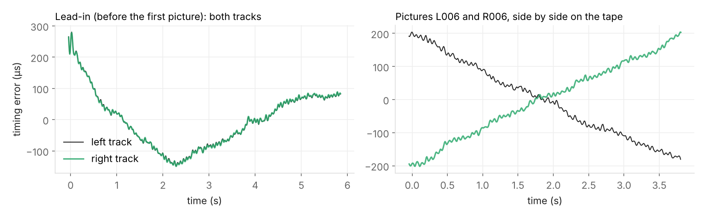
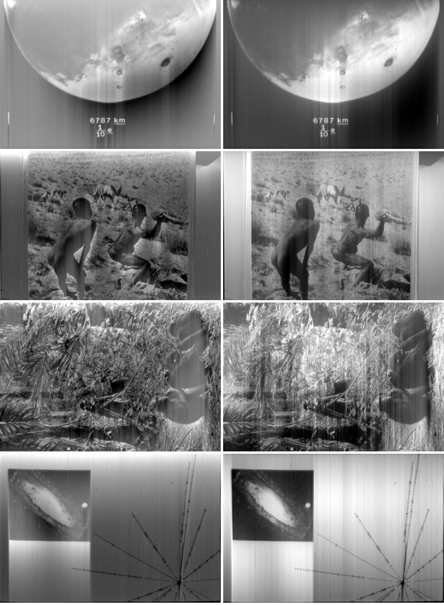

# How the decoder works

This document explains what the picture signal looks like, what goes wrong
with it on tape, and what each processing step does about it. Every number
below was measured on the transfer of the picture section's 1977 master reel
that Ozma Records made in 2017 for the Golden Record reissue: a 384 kHz /
32-bit float stereo WAV file, 474 s long, which is not distributed with this
project. Four sections of it were analysed:

* **the start**: the first 90 s (lead-in tones, then the first 26 pictures,
  from the calibration circle to Jupiter, both channels);
* **two sections from the middle**, 30 s and 112 s long;
* **the end**: the last 88 s (the last pictures, up to the violin with the
  Cavatina score, then silence).

Where something is a hypothesis rather than a measurement, it says so.

Contents

1. [The signal](#1-the-signal)
2. [Processing chain](#2-processing-chain)
3. [Timebase (wow and flutter) correction](#3-timebase-wow-and-flutter-correction)
4. [Droop correction](#4-droop-correction)
5. [Geometry, polarity and colour](#5-geometry-polarity-and-colour)
6. [The 76.8 kHz tone](#6-the-768-khz-tone)
7. [Open questions](#7-open-questions)

---

## 1. The signal

The record cover explains the encoding: each picture is drawn as
**512 vertical lines** of roughly 8 ms each, like television turned
on its side. The pictures were converted to audio in 1977 by Colorado Video
Inc. with a slow-scan television device built to send still pictures over
telephone lines, and recorded on a Honeywell 5600-C instrumentation tape
recorder lent by its manufacturer. A few pages added at the last minute
(President Carter's message and a list of members of Congress) needed a
second session with the same recorder (Carl Sagan's account in *Murmurs of
Earth*). Those pages are not in the picture section of this transfer: it
ends with the last of the 116 pictures, the violin with the Cavatina score.

What the master tape actually carries:

| Property | Measured | Notes |
|---|---|---|
| Line period | 8.320–8.327 ms (3195–3197 samples at 384 kHz) | 1/120 s = 8.333 ms is our speed reference (§3) |
| Lines per picture | 512 on the cover; the framed area is 530–541 lines | the decoder keeps the whole framed area (max. 540) |
| Start marker | ~21 lines of diagonal hatching right before every picture | the precise anchor for the picture's first line |
| Picture duration | ~4.45 s | plus ~80 framing lines before, blank lines after |
| Pictures | one after another on **each** channel independently | the two channels carry different pictures |
| Sync pulse | very sharp positive spike at the start of each line | the steepest edge in the whole signal |
| Sync stagger | pulses alternately early/late by **±130.7 µs** (±50 samples, ~1.6 % of a line) | the "staggered interlace" drawn on the cover |
| Sync shape | the flat top after the spike is short (~0.1 ms) on one line, long (~0.4 ms) on the next | even and odd lines are told apart by it |
| Active picture | ~11.5 % to ~91.5 % of the line after the sync | adjustable in the app |

### The stagger

Consecutive sync-to-sync intervals alternate between ~3297 and ~3097 samples.
The picture content, however, sits on an **even** grid: aligning lines on
their own sync pulse shifts neighbouring lines by ±100 samples, but lines
two apart match perfectly. So the sync pulses are deliberately displaced
early/late around an even grid, and the picture is not. The decoder moves
every pulse back onto the grid before using it (`timebase.destagger`).

After destaggering, the picture content of the two fields (even and odd
lines) lines up: on the edge of the calibration circle the even and odd
columns agree to within 0.2 rows at 768 rows, so no further alignment is
needed. An automatic alignment by cross-correlating the two fields is
available (`render.measure_field_offset`, *Align fields (experimental)*) but
off by default: on this recording it reports a consistent offset of about
±1.85 rows that does not come from the picture. The signal carries a fine
periodic texture (period about 32 rows, roughly 3.6 kHz) whose phase
differs between the two fields, and the correlation locks onto it; applying
the shift makes edges jagged.

Even and odd lines also differ slightly in brightness (3–6 % of full scale),
probably because their sync pulses differ and the chain was AC-coupled;
this shows as fine vertical stripes and is equalised (`render.equalise_fields`).

## 2. Processing chain

```
WAV ──► find candidates ──► line period ──► learn templates ──► measure every pulse
        (rising edges)      (2-line          (aligned fold,      (matched filter,
                             distances)       one per field)      sub-sample, score)
                                                     │
        pictures ◄── picture finder ◄── line runs ◄──┘
        (512+ lines) (blanking structure) (flywheel tracker, dropout bridging)
            │
            ▼
   destagger ─► timebase ─► droop correction ─► sample pixels ─► clamp ─► field levels ─► tone map
```

| Step | Module | What it does |
|---|---|---|
| Candidates | `sync.rising_edges`, `sync.find_candidates` | rising edges measured over *edge scale* (default 20 µs), kept if at least 30 % of the typical per-line maximum |
| Line period | `sync.estimate_period` | histogram of distances to the candidate two lines later (the stagger cancels); a few best rhythms are kept as hypotheses |
| Template | `sync.aligned_fold`, `sync.template_from_fold` | for each hypothesis, ~40 consecutive two-line stretches are aligned by cross-correlation and averaged. Picture content averages out and the sync structure remains; the fold with clear stagger and the sharpest edge wins. Two templates are cut from it, one per field, from 1 % of a line before the rising edge to *template length* (default 4 %) after it |
| Measure | `sync.match`, `sync.detect` | normalised cross-correlation of the whole channel with both templates; peaks above *minimum match* (default 0.6) are refined to a fraction of a sample by parabolic interpolation. Below 150 kHz the signal is first upsampled to ~176 kHz |
| Track | `sync.track_lines`, `sync.merge_runs` | follows the line rhythm, predicts the next pulse from the interval two back (same stagger parity), bridges up to 4 missing pulses, joins runs broken by longer dropouts if the stagger pattern continues |
| Find pictures | `pictures.py` | compares the edges in the blanking part of every line with the median of its own parity (picture lines share the framing structure, other lines do not); the picture starts on the line right after the hatched start marker and runs to the end of the matching stretch |
| Render | `pipeline.Decoder.render`, `render.py` | the steps described below |

Analysing 90 s of the recording (both channels) takes ~14 s; rendering one
picture at 768 rows ~0.3 s.

### Other sample rates and band-limited copies

A short template around the steepest point of the edge (±1 % of a line) is
ample at 384 kHz, but in a 44.1 kHz or 20 kHz-limited copy the edge is
smeared over more than that and picture edges look just as sync-like. That
is why the templates are learned from the recording itself and are longer
(4 % of a line, which includes the pulse's flat top or the beginning of the
blanking that follows), and why the tracker prefers runs of pulses that show
the stagger. Measured on the start section (first 90 s) with default settings:

| Copy | Pictures | Pulses predicted (not found) | Sync timing noise |
|---|---|---|---|
| 384 kHz master-tape transfer | 26 | ~0 % | 1.8 µs |
| same, 20 kHz low-pass | 26 | ~0 % | 2.0 µs |
| same, resampled to 44.1 kHz | 26 | ~0 % | 2.1 µs |

The rendered pictures differ by only 0.6–1.5 % (RMS) between the 384 kHz
and the 20 kHz-limited versions when the same timing is used, so the
picture itself fits within the audio band; what the extra bandwidth buys is
slightly more precise sync timing.

## 3. Timebase (wow and flutter) correction

Every sync pulse is a timing reference: where line *k* actually starts on the
tape. With a perfect transport those times would lie on a straight line.
The difference from the best straight line is the **timing error**.

Measured on 25 complete pictures:

| | median | range |
|---|---|---|
| timing error, rms | 21 µs | 9–52 µs |
| timing error, peak-to-peak | 95 µs | up to 212 µs |
| mean speed vs 120 Hz lines | +700 to +2100 ppm | rises slowly from the start to the end of the reel, on both tracks |

95 µs peak-to-peak is ~1.1 % of a line: enough to bend straight edges and
smear detail. The error spectrum has most of its energy below 5 Hz (wow),
(58–96 % of the error power below 5 Hz), plus flutter components on some
pictures, e.g. a clear ~13 Hz oscillation of ±10 µs on picture L004.

The decoder offers three timebase modes (`timebase.py`):

* **Fixed speed** – the classic approach: one constant speed per picture
  (measured automatically, with an optional manual trim).
* **Sync-locked, per line** – straight segments between consecutive
  measured pulses.
* **Sync-locked, smoothed** (default) – the timing error is low-pass
  filtered (zero phase) at a chosen bandwidth and interpolated with a cubic
  spline, so the correction is smooth *inside* each line too.

### Choosing the bandwidth

The line rate is 120 Hz, so corrections up to 60 Hz can be measured. To
choose the bandwidth we measured how similar neighbouring lines are (mean
correlation of their vertical derivatives — timing errors make neighbours
differ) on all 25 pictures:

| mode | fixed | 5 Hz | 10 Hz | 20 Hz | 30 Hz | **40 Hz** | 50 Hz | per line |
|---|---|---|---|---|---|---|---|---|
| mean neighbour correlation | 0.338 | 0.341 | 0.349 | 0.370 | 0.375 | **0.377** | 0.376 | 0.375 |

Improvement keeps increasing up to 40 Hz and flattens after it, which means
the fast timing variations are real and worth correcting, while the last
bit is measurement noise (~0.7 sample per pulse). 40 Hz is the default.

### Where do the errors come from?

Both tracks pass the same replay head at the same moment, so errors made by
the **replay** machine during the transfer are identical on both. Measured on
the start and the two middle sections (destaggered sync times, each track's own
linear trend removed):

* **Lead-in** (before the first picture, the same signal on both tracks):
  the two tracks agree to 1.5 µs rms over 6 s while each wanders by ~90 µs
  (r = 1.000). Replay errors are therefore common to both tracks, and
  dynamic azimuth (tape skew) contributes at most ~1 µs between them.
* **Pictures** (34 left/right pairs that overlap on the tape): the two tracks
  run at line rates that differ by −48 to +202 ppm, changing from pair to
  pair, and their flutter is largely independent (pooled coherence 0.04–0.18
  between 1 and 30 Hz). Static or dynamic azimuth cannot cause a sustained
  rate difference: 200 ppm over a 4 s picture builds up to 800 µs.

So the tracks were not recorded together: each track's pictures were laid
down separately, most likely one take at a time, each with its own speed and
wow. A replay-only correction (for example from a pilot tone) could not
remove these errors; the sync pulses, recorded together with the picture,
can.



### Speed calibration

The cover only says "about 8 milliseconds". The measured period is
8.32–8.33 ms, within 0.15 % of 1/120 s. Slow-scan equipment of the time was
typically locked to the 60 Hz mains / TV field rate, so we use 1/120 s as
the nominal line period and report the speed of every picture relative to
it (*hypothesis*: if the original equipment ran at another rate, only the
reported number changes, not the pictures). In sync-locked modes the speed
needs no setting — it is measured continuously from the pulses; the
*Speed trim* control only applies to the fixed-speed mode.

## 4. Droop correction

Following every large level change, the signal decays back toward zero
with a time constant of about a millisecond: the recording chain was
AC-coupled (a high-pass filter). In the picture this produces dark shadows
under bright objects, bright halos, and shading down every line. It also
makes the picture look artificially crisp, because a high-pass filter acts
like an unsharp mask.

The decoder models this as a first-order high-pass with time constant τ and
applies the exact inverse, `x = y + (1/τ)∫y dt` (with a 50 ms leak so that DC
offsets cannot accumulate).

τ is measured, not guessed. Every second sync pulse has a ~0.4 ms flat top
that, as recorded, slopes downward. After correct compensation it is flat.
Because the correction is linear in 1/τ, the τ that makes all these tops flat
follows directly from a least-squares fit (`render.estimate_droop_tau`).
Measured: **τ ≈ 0.77–0.86 ms on the left channel, 0.47–0.52 ms on the right**,
stable from picture to picture.



*Droop correction off (left) and on (right), on Mars and Mercury. With it
on, the planets sit on black space instead of a grey gradient.*

After droop correction, a per-line **clamp** subtracts the level of the
"back porch" (5.5–10 % of the line, just after the sync pulse) to remove the
remaining line-to-line level jumps (vertical streaks).

## 5. Geometry, polarity and colour

**Polarity.** On this recording a higher signal means a darker picture: with
inversion on, the Sun and planets are bright on black space and the
drawings are dark on white. Inversion is the default.

**Aspect ratio.** Picture 1 is a circle, also drawn on the cover, so that the
decoding can be checked. With the default active window (0.115–0.915 of a
line), the circle is round at a display aspect of **1.485** (width / height,
defined for a width of 512 lines; pictures with more lines get proportionally
wider). "Calibrate aspect from circle" in the app measures it again for other
settings (`render.measure_circle_aspect`): it fits an ellipse to the ring's
pixels, away from the bright and dark edges of the framed area, and refuses
pictures that are not a complete ring.

**Colour.** Colour pictures were recorded as three separate frames of the
same scene, red, green and blue, in that order (the decoder's default; the
app still lets you try the other orders). The decoder flags candidates by
comparing blurred edge maps of neighbouring pictures (separations share
edges but not brightness) and registers the three frames to each other
before combining them. The
solar spectrum (three frames in which a bright band moves across) cannot be
detected this way, because its separations differ in content; combine it by
hand.

## 6. The 76.8 kHz tone

The transfer contains a faint steady tone near 76.8 kHz on both channels
(about −95 dBFS; 35–43 dB above the local noise floor in a 0.02–0.07 Hz
analysis bandwidth). We tested whether it
was recorded on the tape (for example leftover bias), because a tone on the
tape would track wow and flutter and could be used to correct them.

It is not on the tape:

* Its frequency is **76,807.05 Hz** in the start and the 30 s middle section (agreeing within 0.01 Hz)
  and stays within about ±1 ppm over time. A tone on tape would wander by
  hundreds of ppm with the tape speed.
* The phase of the tone predicts timing errors of ±0.5 µs; the sync pulses
  on the same channel show ±40 µs, with no correlation (r = −0.08).
* It is 92 ppm away from exactly 1/5 of the sample rate, so it is not
  simply a spur of the converter clock either. Most likely it is an
  independent oscillator somewhere in the transfer chain.


## 7. Open questions

* **Why the sync pulses are staggered** by ±131 µs while the picture is not.
  A field marker for the receiver is the most likely reason; no Colorado
  Video documentation has been found to confirm it.
* **The fine periodic texture** (~3.6 kHz) whose phase differs between the
  two fields: where it enters the chain.
* **Droop model.** A single high-pass pole explains most of the low-frequency
  loss; the chain may have more than one (camera, CVI device, tape recorder).
* **Nominal line period.** 1/120 s is an inference from the measured period
  and 1970s US equipment, not a documented value.

Measurements and plots in this document can be reproduced with the
command-line tool (`--timing-csv` writes per-line timing for every picture).

---

*This document and the decoder's code were written by Claude (Anthropic),
working with Carlos Nascimento of Qualia Audio Lab, who directed the work and
made the measurements and listening tests.*
