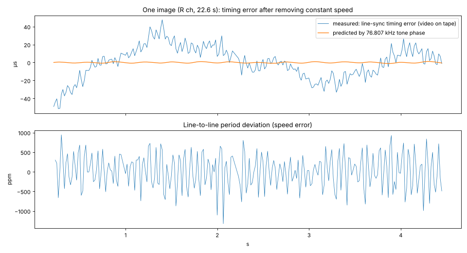

# How the decoder works

This document explains what the picture signal looks like, what goes wrong
with it on tape, and what each processing step does about it. Every number
below was measured on a 384 kHz / 32-bit float stereo transfer of the 1977
master tape of the picture section (two excerpts: the first 90 s and 30 s
from the middle). Where something is a hypothesis rather than a measurement,
it says so.

Contents

1. [The signal](#1-the-signal)
2. [Processing chain](#2-processing-chain)
3. [Timebase (wow and flutter) correction](#3-timebase-wow-and-flutter-correction)
4. [Droop correction](#4-droop-correction)
5. [Geometry, polarity and colour](#5-geometry-polarity-and-colour)
6. [The 76.8 kHz tone](#6-the-768-khz-tone)
7. [Open questions](#7-open-questions)

---

## 1. The signal

The record cover explains the encoding: each picture is drawn as
**512 vertical lines** of roughly 8 ms each, like television turned
on its side. The pictures were converted to audio in 1977 by Colorado Video
Inc. with a slow-scan television device built to send still pictures over
telephone lines.

What the master tape actually carries:

| Property | Measured | Notes |
|---|---|---|
| Line period | 8.320–8.327 ms (3195–3197 samples at 384 kHz) | 1/120 s = 8.333 ms is our speed reference (§3) |
| Lines per picture | 512 | as on the cover |
| Picture duration | 4.27 s | plus ~100 framing lines before, blank lines after |
| Pictures | one after another on **each** channel independently | the two channels carry different pictures |
| Sync pulse | very sharp positive spike at the start of each line | the steepest edge in the whole signal |
| Sync stagger | pulses alternately early/late by **±130.7 µs** (±50 samples, ~1.6 % of a line) | the "staggered interlace" drawn on the cover |
| Sync shape | the flat top after the spike is short (~0.1 ms) on one line, long (~0.4 ms) on the next | even and odd lines are told apart by it |
| Active picture | ~11.5 % to ~91.5 % of the line after the sync | adjustable in the app |

### The stagger

Consecutive sync-to-sync intervals alternate between ~3297 and ~3097 samples.
The picture content, however, sits on an **even** grid: aligning lines on
their own sync pulse shifts neighbouring lines by ±100 samples, but lines
two apart match perfectly. So the sync pulses are deliberately displaced
early/late around an even grid, and the picture is not. The decoder moves
every pulse back onto the grid before using it (`timebase.destagger`).

After that there is still a small, consistent vertical offset between the
two fields (even and odd lines) of about ±1.85 rows at 768 rows. The decoder
measures it from the picture itself and removes it (`render.measure_field_offset`).
Even and odd lines also differ slightly in brightness (3–6 % of full scale),
probably because their sync pulses differ and the chain was AC-coupled;
this shows as fine vertical stripes and is equalised (`render.equalise_fields`).

## 2. Processing chain

```
WAV ──► find candidates ──► line period ──► sync template ──► measure every pulse
        (steep edges)       (2-line          (median pulse      (cross-correlation,
                             distances)       shape, per ch)     sub-sample, score)
                                                     │
        pictures ◄── picture finder ◄── line runs ◄──┘
        (512 lines)  (blanking structure) (flywheel tracker, dropout bridging)
            │
            ▼
   destagger ─► timebase ─► droop correction ─► sample pixels ─► clamp ─► field align ─► tone map
```

| Step | Module | What it does |
|---|---|---|
| Candidates | `sync.find_candidates` | every edge whose slope is at least 30 % of the typical per-line maximum |
| Line period | `sync.estimate_period` | histogram of distances to the candidate two lines later (stagger cancels); the picture rhythm is the one with the most staggered pulses (lead-in signals have other rhythms) |
| Template | `sync.build_template` | median shape of genuine, staggered sync pulses (±1 % of a line around the spike, where both pulse types agree) |
| Measure | `sync.refine` | normalised cross-correlation with the template; parabolic peak interpolation gives sub-sample position; the correlation (0–1) rejects picture edges |
| Track | `sync.track_lines`, `sync.merge_runs` | follows the line rhythm, predicts the next pulse from the interval two back (same stagger parity), bridges up to 4 missing pulses, joins runs broken by longer dropouts if the stagger pattern continues |
| Find pictures | `pictures.py` | compares the edges in the blanking part of every line with the median of its own parity; picture lines share the framing structure, other lines do not; 512 lines are placed on the matching stretch |
| Render | `pipeline.Decoder.render`, `render.py` | the steps described below |

Analysis of the 90 s excerpt (both channels) takes ~6 s; rendering one
picture at 768 rows ~0.3 s.

## 3. Timebase (wow and flutter) correction

Every sync pulse is a timing reference: where line *k* actually starts on the
tape. With a perfect transport those times would lie on a straight line.
The difference from the best straight line is the **timing error**.

Measured on 25 complete pictures:

| | median | range |
|---|---|---|
| timing error, rms | 21 µs | 9–52 µs |
| timing error, peak-to-peak | 95 µs | up to 212 µs |
| mean speed vs 120 Hz lines | +700 to +1500 ppm | drifts slowly through the file |

95 µs peak-to-peak is ~1.1 % of a line: enough to bend straight edges and
smear detail. The error spectrum has most of its energy below 5 Hz (wow),
(58–96 % of the error power below 5 Hz), plus flutter components on some
pictures, e.g. a clear ~13 Hz oscillation of ±10 µs on picture L004.

The decoder offers three timebase modes (`timebase.py`):

* **Fixed speed** – the classic approach: one constant speed per picture
  (measured automatically, with an optional manual trim).
* **Sync-locked, per line** – straight segments between consecutive
  measured pulses.
* **Sync-locked, smoothed** (default) – the timing error is low-pass
  filtered (zero phase) at a chosen bandwidth and interpolated with a cubic
  spline, so the correction is smooth *inside* each line too.

### Choosing the bandwidth

The line rate is 120 Hz, so corrections up to 60 Hz can be measured. To
choose the bandwidth we measured how similar neighbouring lines are (mean
correlation of their vertical derivatives — timing errors make neighbours
differ) on all 25 pictures:

| mode | fixed | 5 Hz | 10 Hz | 20 Hz | 30 Hz | **40 Hz** | 50 Hz | per line |
|---|---|---|---|---|---|---|---|---|
| mean neighbour correlation | 0.338 | 0.341 | 0.349 | 0.370 | 0.375 | **0.377** | 0.376 | 0.375 |

Improvement keeps increasing up to 40 Hz and flattens after it, which means
the fast timing variations are real and worth correcting, while the last
bit is measurement noise (~0.7 sample per pulse). 40 Hz is the default.

### Where do the errors come from?

Both channels pass the same replay head at the same moment, so errors made
by the **replay** machine during the transfer would be identical on both
channels. Comparing the timing errors of the two channels over the same
stretch of tape: below 5 Hz they correlate on some stretches (r up to 0.99)
and not at all on others; above 5 Hz they are mostly uncorrelated. So most
of the error was recorded **into** each channel when the pictures were put on
tape in 1977 (each channel's pictures were laid down separately), and only
part comes from the transfer. A replay-only correction (for example from a
pilot tone) could not remove it; the sync pulses, recorded together with the
picture, can.

### Speed calibration

The cover only says "about 8 milliseconds". The measured period is
8.32–8.33 ms, within 0.15 % of 1/120 s. Slow-scan equipment of the time was
typically locked to the 60 Hz mains / TV field rate, so we use 1/120 s as
the nominal line period and report the speed of every picture relative to
it (*hypothesis*: if the original equipment ran at another rate, only the
reported number changes, not the pictures). In sync-locked modes the speed
needs no setting — it is measured continuously from the pulses; the
*Speed trim* control only applies to the fixed-speed mode.

## 4. Droop correction

Following every large level change, the signal decays back toward zero
with a time constant of about a millisecond: the recording chain was
AC-coupled (a high-pass filter). In the picture this produces dark shadows
under bright objects, bright halos, and shading down every line. It also
makes the picture look artificially crisp, because a high-pass filter acts
like an unsharp mask.

The decoder models this as a first-order high-pass with time constant τ and
applies the exact inverse, `x = y + (1/τ)∫y dt` (with a 50 ms leak so that DC
offsets cannot accumulate).

τ is measured, not guessed. Every second sync pulse has a ~0.4 ms flat top
that, as recorded, slopes downward. After correct compensation it is flat.
Because the correction is linear in 1/τ, the τ that makes all these tops flat
follows directly from a least-squares fit (`render.estimate_droop_tau`).
Measured: **τ ≈ 0.77–0.86 ms on the left channel, 0.47–0.52 ms on the right**,
stable from picture to picture.


*Droop correction off (left) and on (right). With it on, Mars sits on black
space instead of a grey gradient, and the people in the third picture lose
their light halos.*

After droop correction, a per-line **clamp** subtracts the level of the
"back porch" (5.5–10 % of the line, just after the sync pulse) to remove the
remaining line-to-line level jumps (vertical streaks).

## 5. Geometry, polarity and colour

**Polarity.** On this recording a higher signal means a darker picture: with
inversion on, the Sun and planets are bright on black space and the
drawings are dark on white. Inversion is the default.

**Aspect ratio.** Picture 1 is a circle, also drawn on the cover, so that the
decoding can be checked. With the default active window (0.115–0.915 of a
line), the circle is round at a display aspect of **1.485** (width / height).
"Calibrate aspect from circle" in the app measures it again for other
settings (`render.measure_circle_aspect`).

**Colour.** Colour pictures were recorded as three separate frames of the
same scene, one after another. The decoder flags candidates by comparing
blurred edge maps of neighbouring pictures (separations share edges but not
brightness) and registers the three frames to each other before combining
them. The order of the colours in the triple is **not documented**; the
default R, G, B is an assumption, and the app lets you try all six orders.
The solar spectrum (three frames in which a bright band moves across) cannot
be detected this way, because its separations differ in content; combine it
by hand. If the orientation of the spectrum in the original picture is
known, it would settle the colour order.

## 6. The 76.8 kHz tone

The transfer contains a faint steady tone near 76.8 kHz on both channels
(about −95 dBFS; 35–43 dB above the local noise floor in a 0.02–0.07 Hz
analysis bandwidth). We tested whether it
was recorded on the tape (for example leftover bias), because a tone on the
tape would track wow and flutter and could be used to correct them.

It is not on the tape:

* Its frequency is **76,807.05 Hz** in both excerpts (agreeing within 0.01 Hz)
  and stays within about ±1 ppm over time. A tone on tape would wander by
  hundreds of ppm with the tape speed.
* The phase of the tone predicts timing errors of ±0.5 µs; the sync pulses
  on the same channel show ±40 µs, with no correlation (r = −0.08).
* It is 92 ppm away from exactly 1/5 of the sample rate, so it is not
  simply a spur of the converter clock either. Most likely it is an
  independent oscillator somewhere in the transfer chain.



## 7. Open questions

* **Colour order** of the separations (see §5).
* **Why the fields are offset** by ~1.85 rows after destaggering, and
  whether the cover's interlace drawing intends a specific half-line shift.
* **Droop model.** A single high-pass pole explains most of the low-frequency
  loss; the chain may have more than one (camera, CVI device, tape recorder).
* **Nominal line period.** 1/120 s is an inference from the measured period
  and 1970s US equipment, not a documented value.

Measurements and plots in this document can be reproduced with the
command-line tool (`--timing-csv` writes per-line timing for every picture).
